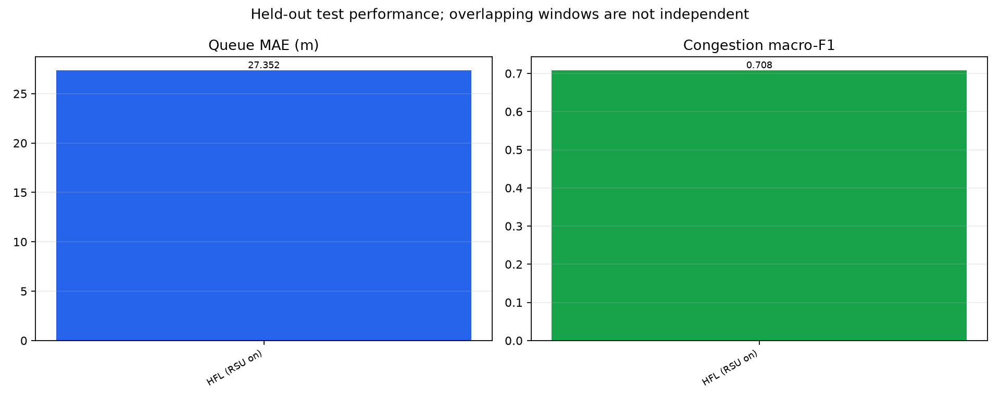
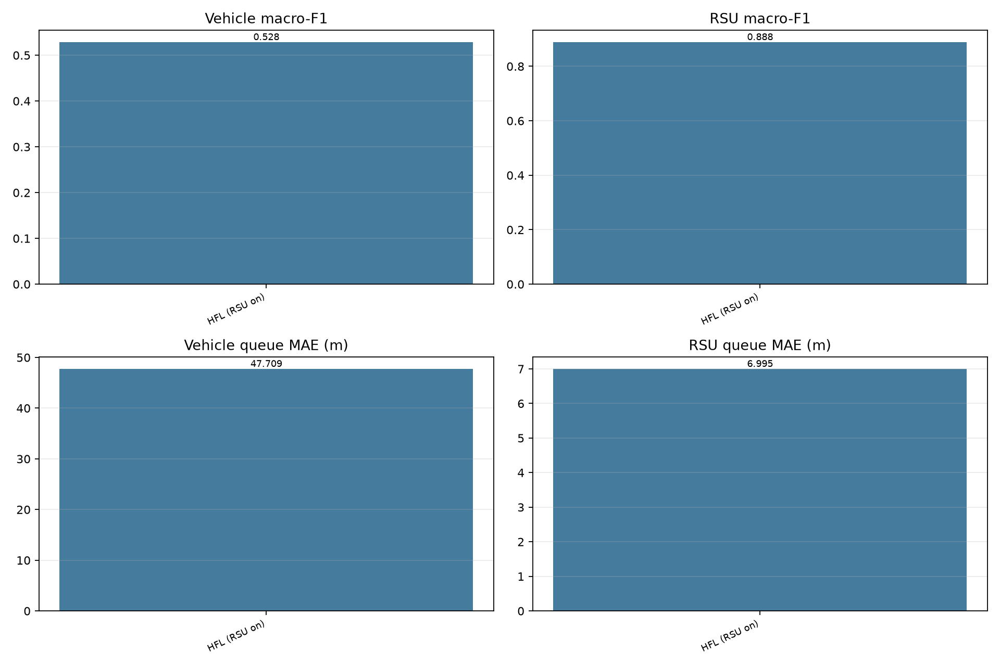
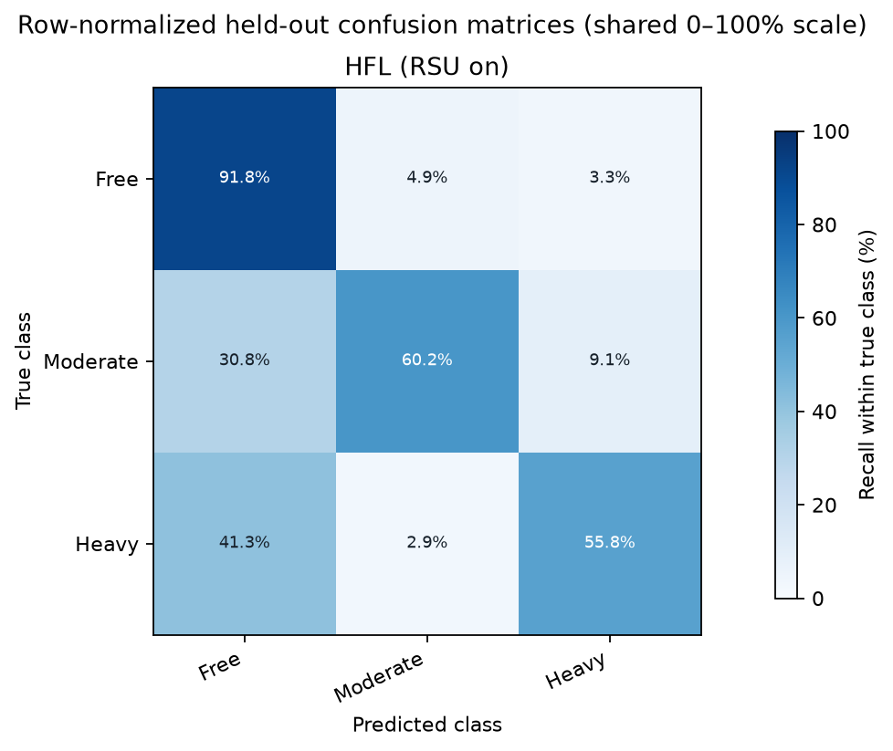
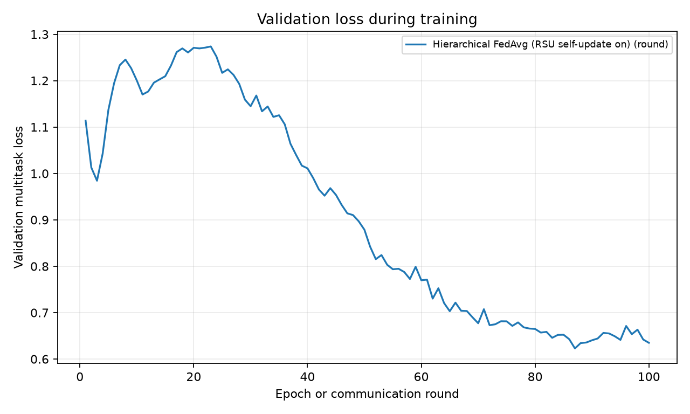
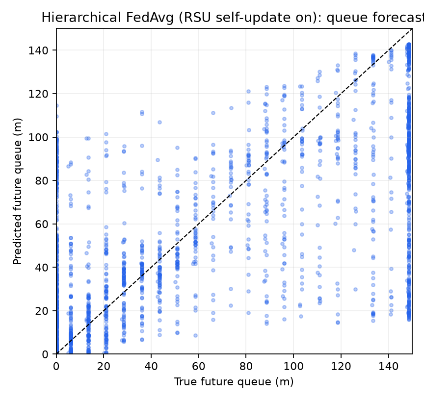

# TRAF-MA run report: Hierarchical FedAvg (RSU self-update on)

This report uses only the saved experiment run artifacts supplied to this command. Scores are descriptive; overlapping sliding windows are not independent samples.

## Results

| Method | Train windows | Test N | Queue MAE (m) | Queue RMSE (m) | Macro-F1 | Balanced accuracy |
|---|---:|---:|---:|---:|---:|---:|
| Hierarchical FedAvg (RSU self-update on) | 14,000 | 14,000 | 27.352 | 42.185 | 0.7078 | 0.6925 |

## Figures

## Run provenance

### Hierarchical FedAvg (RSU self-update on)

- Run folder: `artifacts/phase2_compact_350_hfl_rsu_on_7000each/training_run`
- Duration: 40.3 min; training: 100 rounds.
- Training window count: 14,000.
- Test windows: 14,000.
- Run manifest SHA-256: `2efe03a811a2474b7f1246d921cb1ba1bdc0ed25003c8df500202fd123cac86f`.
